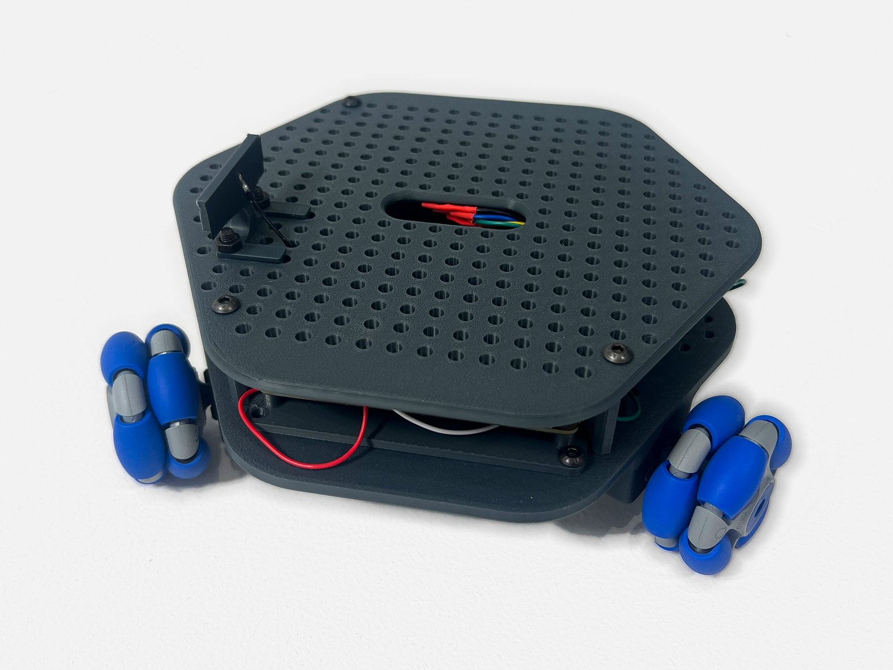
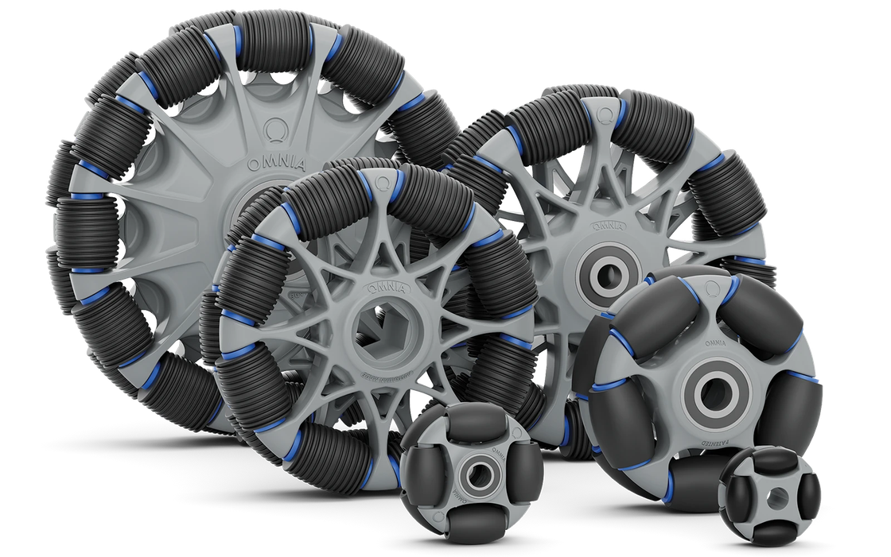
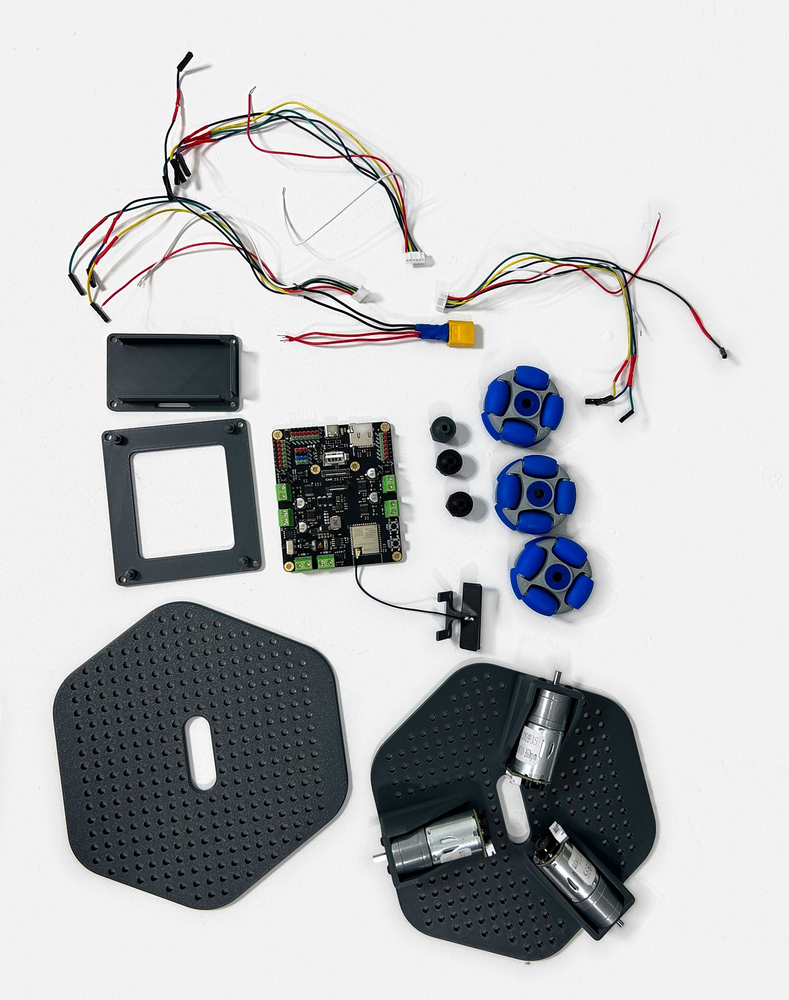
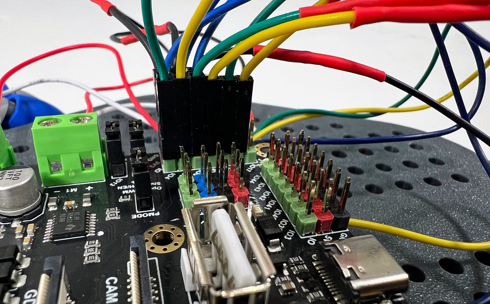
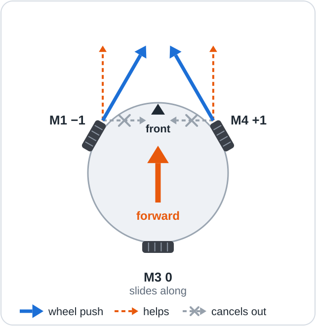
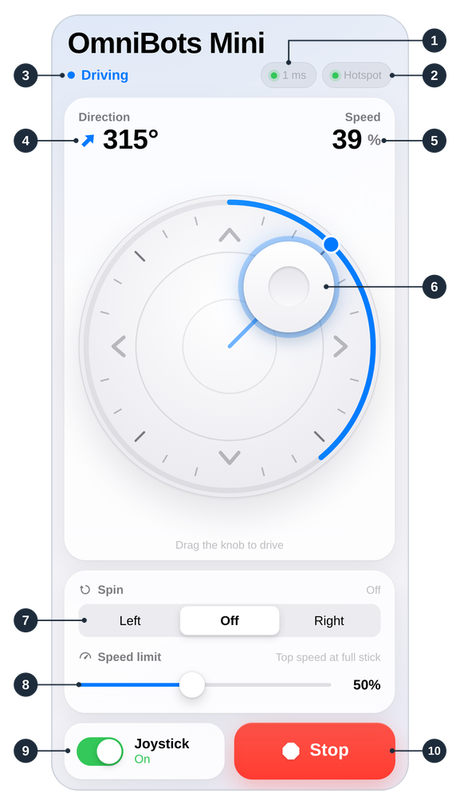

# Mini Omni Bot

**Status: prototype.** The robot has been built and driven, but the chassis print files are not
published yet and the battery has not been selected. See [known limitations](#known-limitations).

Mini Omni Bot is an open-source educational robot that moves in any direction. Its three
[Omni Wheels by Omnia](https://www.rotacaster.com.au/shop/rotacaster-wheels/index?preview=1) each
push one way and slide the other, so the robot drives forward, sideways or diagonally and turns on
the spot without steering. The guides lead a beginner from a set of parts to a driving robot.

## What you can do with it

- Build the robot from photographed steps and wire it to a DFRobot Romeo ESP32-S3 board.
- Learn the code in five short Arduino lessons, one idea at a time.
- Drive it from a phone over its own WiFi hotspot, or with commands typed over USB.
- Follow the theory of a kiwi drive: the wheel formula, motor drivers, PWM and encoders.
- Build the program for other ESP32, Arduino and STM32 boards with separate motor drivers.

## Guides

| [1. Build](docs/02_Assembly.md) | [2. Wire](docs/03_Wiring.md) | [3. Learn](firmware/lessons/README.md) | [4. Drive](docs/06_Phone_Joystick.md) |
|:---:|:---:|:---:|:---:|
|  |  |  |  |

Begin with [Getting started](docs/01_Getting_Started.md). The [guide index](docs/README.md) gives
the full route and a quick start for experienced makers.

## Parts

Three Omni Wheels by Omnia, available from Omnia Wheel; three DFRobot FIT0493 12 V motors with
encoders; a DFRobot Romeo ESP32-S3 board; a 12 V battery and charger (pack not yet selected); and
a 3D printed chassis with screws and nuts. The [parts list](hardware/BOM.md) gives every item.
Battery charging needs adult supervision: read [Safety](docs/01_Getting_Started.md#safety) first.

## Project status

Prototype: the robot has been built and driven with the Romeo board. Feedback is welcome on the
[Issues page](https://github.com/LazarevMike/Mini_Omni_Bot/issues).

### Known limitations

- **Chassis:** the print files, drawings, print settings and screw sizes are not published yet.
- **Battery:** the pack and charger have not been selected.
- **Arduino IDE:** the Arduino IDE 2 route has not been tested on hardware.
- **Lessons:** the five lessons have been compile-checked on ESP32 Arduino core 2.0.17, but have not
  all been run on the robot.
- **Example outputs:** the program outputs printed in the guides, and the Serial Monitor picture,
  are examples, not captures from the robot.
- **Photos:** the photos show the prototype. In Assembly, step 9, the battery holder is in an
  earlier position.
- **Other boards:** the program builds for them, but only the Romeo has driven the robot.

## Licences

Copyright 2026 Omnia Wheel.

| Covers | Licence |
|--------|---------|
| Code: `firmware/`, `web/`, `tools/` | [MIT](LICENSE) |
| Hardware: `hardware/` (3D models, drawings, parts list) | [CERN-OHL-P v2](hardware/LICENSE) |
| Documentation and pictures: `docs/`, `CONTRIBUTING.md`, and the READMEs outside `hardware/` | [CC BY 4.0](docs/LICENSE) |
