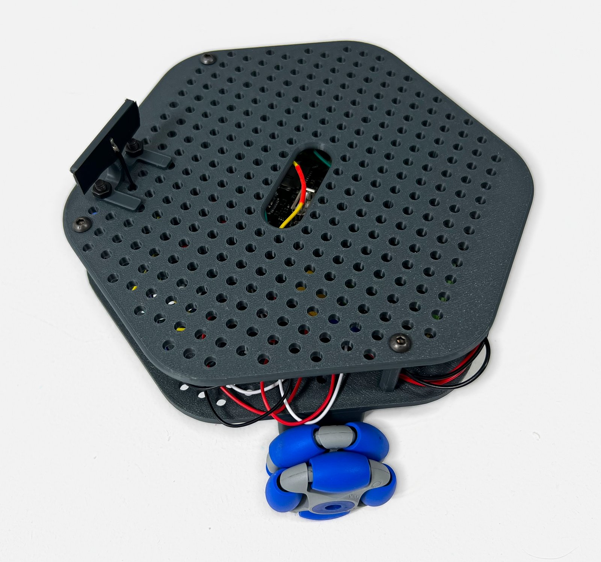
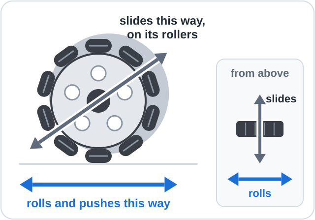
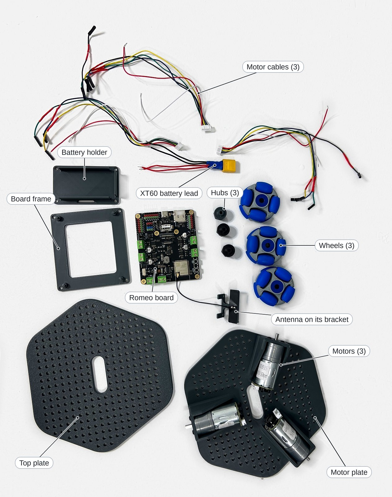

# Getting started

This page introduces Mini Omni Bot, lists the parts and tools needed to build it, and sets out
the safety rules.

**Objectives**

- Describe how three omni wheels in a kiwi drive let Mini Omni Bot move in any direction.
- Identify the parts and tools needed to build the robot.
- Apply the safety rules for the LiPo battery and for working near a moving robot.

## What it is

Mini Omni Bot is a three-wheel robot that moves in any direction and turns on the spot. Each
wheel, an Omni Wheel by Omnia, is an **omni wheel**: a wheel with free-turning rollers around its rim, so
that it pushes along its rolling direction and slides along its axle.

The three wheels sit 120° apart, a layout called a **kiwi drive**.

> [!NOTE]
> **Key idea:** the robot moves in the direction in which the pushes of its three wheels add
> up. Changing the balance of power between the wheels changes that direction, so the robot
> needs no steering. [How it works](07_How_It_Works.md) derives the formula.

The controller, a DFRobot Romeo ESP32-S3 board, carries an ESP32-S3 **microcontroller**, a
small computer on one chip with WiFi, and four **motor drivers**, circuits that switch battery
power to a motor in either direction. An **encoder** on each motor produces pulses as the
wheel turns, so the program can measure distance and speed.

### Specification

| Item | Specification |
|------|---------------|
| Drive | 3 × Omni Wheels by Omnia, 120° apart (kiwi drive) |
| Controller | DFRobot Romeo ESP32-S3 (DFR0994), with WiFi and Bluetooth |
| Motor drivers | 4 × DRV8876 on the board, rated 2.5 A per motor; M1, M3 and M4 are used |
| Motors | 3 × DFRobot FIT0493: 12 V, 350 rpm no-load, 34:1 gearbox, 12 kg.cm stall torque |
| Encoders | 1496 counts per wheel revolution |
| Power | 12 V battery on VM and VIN through a split lead, for example a 3S LiPo (to be confirmed); USB-C powers the controller only |
| Control | A phone's web browser over WiFi, or commands typed over USB |
| Programming | Arduino (C++), in Arduino IDE 2 or PlatformIO |

## Parts and tools

The picture leaves out the three pillars, the screws and nuts, the battery, the charger and the
USB cable.

| Qty | Main part | Notes |
|-----|-----------|-------|
| 1 | DFRobot Romeo ESP32-S3 (DFR0994), with its WiFi antenna | Controller, WiFi and motor drivers |
| 3 | DFRobot FIT0493 motors with encoders | 12 V, 350 rpm, each with a six-wire cable |
| 3 | Omni Wheels by Omnia, 50 mm | From the [Omnia Wheel shop](https://www.rotacaster.com.au/shop/50mm-omni-wheels/index) |
| 1 | 12 V battery and charger | Not yet selected: wait for the recommended pack |
| 1 | Battery lead with an XT60 plug | Joins the battery to the board |
| 1 set | 3D printed chassis parts | Motor plate, top plate, board frame, battery holder, antenna bracket, 3 hubs and 3 pillars ([hardware/](../hardware/README.md)) |

The [parts list](../hardware/BOM.md) gives the complete list, with leads, fasteners and example
suppliers.

### Tools

| Tool | Purpose |
|------|---------|
| Small cross-head or flat screwdriver, hex key | The board's screw terminals; chassis screws |
| Tweezers, masking tape | Fitting jumpers, marking the motor wires during assembly |
| Multimeter (optional) | Checking battery voltage and polarity |
| 3D printer | Printing the chassis (a school, library or makerspace can help) |
| Mug or small box | Raising the robot so that its wheels hang free |
| Computer and phone | Uploading programs; driving the robot |

## Safety

> [!CAUTION]
> A LiPo battery can catch fire if it is damaged, short-circuited, overcharged or fully
> discharged. An adult should supervise every charge.

### Battery care

1. Charge only with a LiPo balance charger set for the pack (3 cells for 11.1 V), on a
   non-flammable surface such as a tile or a LiPo bag, and never leave it unattended.
2. Stop driving when the robot slows down, then disconnect the battery. The robot does not
   measure its battery voltage; a plug-in LiPo alarm can give a warning.
3. Store the battery cool, dry and away from metal objects, about half charged if it will not
   be used for a week or more.
4. Stop using a battery that is swollen, dented or hot, and take it to a battery recycling
   point.

### Working near a moving robot

- Keep fingers, hair and loose cables away from the wheels; the geared motors can pinch.
- Test anything new (an upload, a lesson, the `test` command) with the wheels raised on a mug,
  and drive on the floor, never on a table.
- To stop the robot, press Stop on the **driving page**, the web page that the robot serves to
  the phone, or type `x` and press Enter in the **Serial Monitor**, the robot's text window on
  the computer. As a last resort, lift the robot and switch **SW**, the board's power switch,
  off. Unplugging USB does not stop the motors.
- Switch SW off and disconnect the battery before changing any wiring; SW does not disconnect
  the battery.

## Glossary

| Term | Meaning |
|------|---------|
| Omni wheel | A wheel with free-turning rollers on its rim, so that it pushes one way and slides the other |
| Kiwi drive | Three omni wheels spaced 120° apart |
| Microcontroller | A small computer on one chip that runs a program and controls its pins |
| Motor driver | A circuit that switches battery power to a motor in either direction |
| H-bridge | The four-switch circuit in a motor driver that sets the motor's direction |
| PWM | Pulse-width modulation: rapid on-off switching whose duty cycle, the fraction of time on, sets the power |
| Encoder | A sensor that produces two square waves as the motor turns, giving distance and direction |
| Interrupt | A signal that pauses the program to run a short function, so that no encoder count is missed |
| Sketch | An Arduino program: a `.ino` file in a folder of the same name |
| Upload | To compile a program and write it to the board over USB |
| Serial Monitor | The robot's text window over USB (Arduino IDE 2: Tools > Serial Monitor; PlatformIO: the Serial Monitor button) |
| Hotspot | A WiFi network created by the robot itself |
| Jumper | A small cap that connects two pins |
| VM | The Romeo's motor power input (5 to 24 V), where the battery connects, with a second pair on VIN |
| LiPo (3S) | A lithium polymer battery; 3S means three cells in series (11.1 V) |

## Summary

- Three omni wheels in a kiwi drive let Mini Omni Bot move in any direction without steering.
- The Romeo ESP32-S3 combines the microcontroller, WiFi and motor drivers; encoders measure
  each wheel's rotation.
- Charge LiPo batteries under supervision, and test new code with the wheels raised.

**Next:** [Assembly](02_Assembly.md): build the robot.
