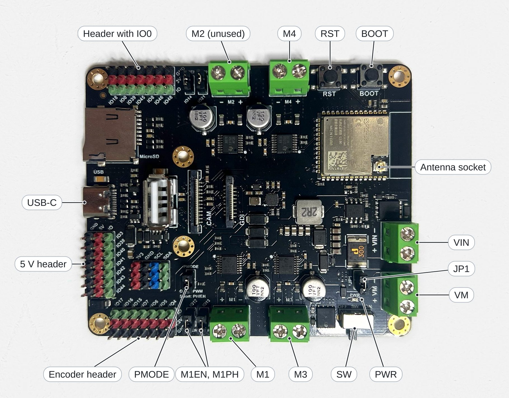
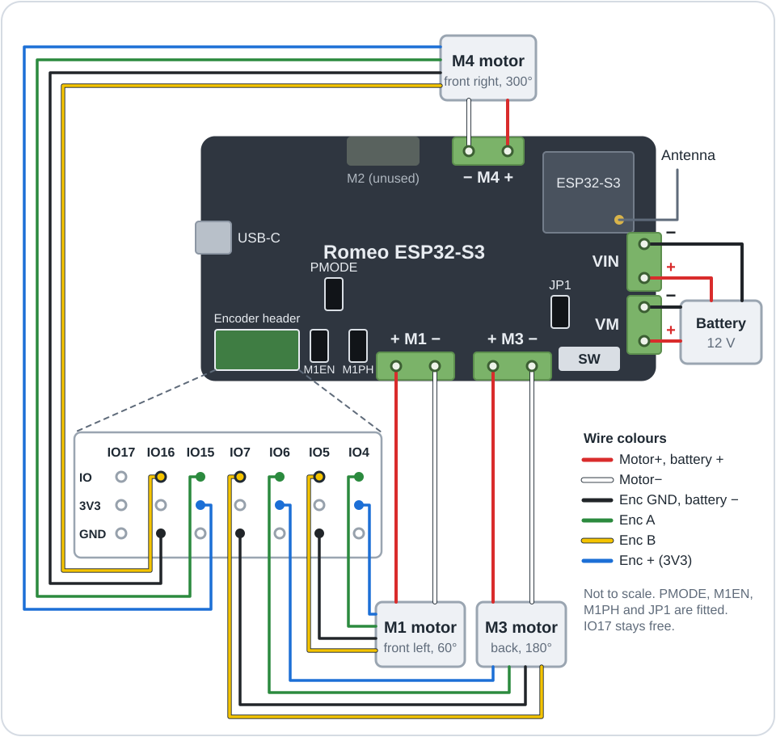
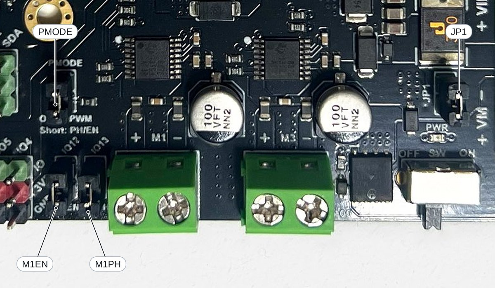
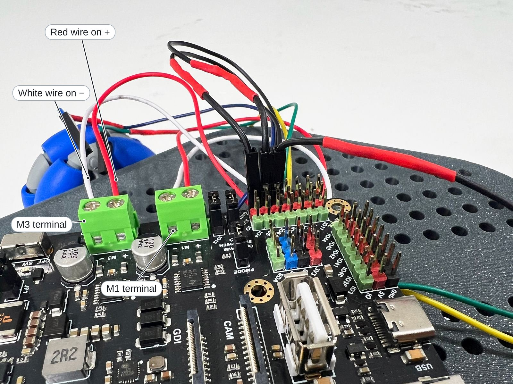
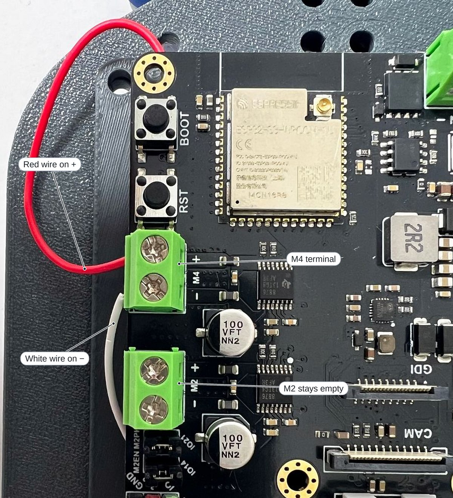
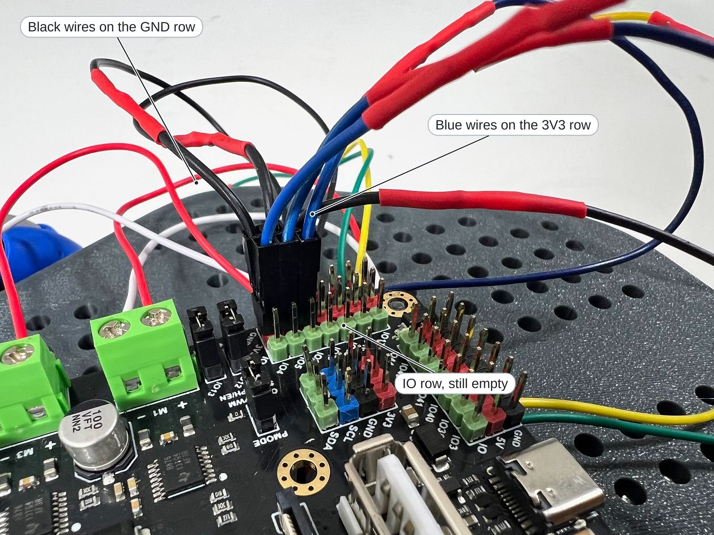
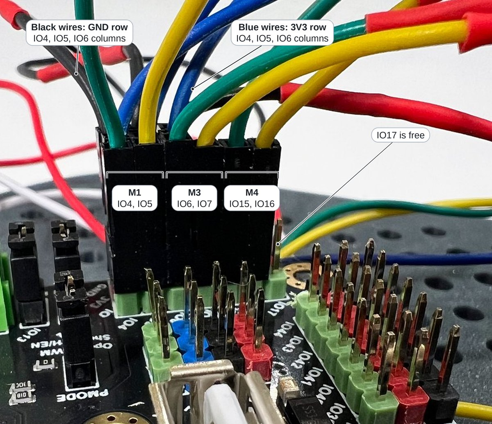
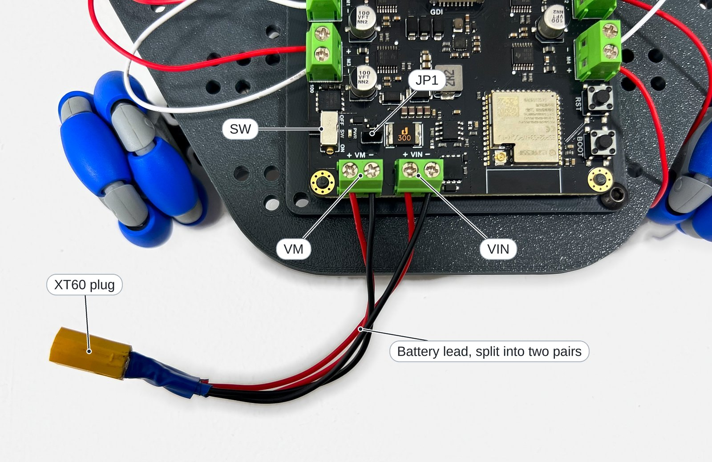

# Wiring

This page connects the motors, their **encoders** (sensors that measure wheel rotation) and the
battery to the Romeo ESP32-S3 board, as
[Assembly, step 7](02_Assembly.md#7-wire-the-board), with the board on its pegs and the motor
cables up through the centre slot.

**Objectives**

- Identify the sockets, jumpers and headers that Mini Omni Bot uses.
- Connect each motor and encoder to the correct socket and pins.
- Explain why the encoders use 3V3 and avoid the strapping pins.

For another controller with separate motor drivers, follow [Other boards](08_Other_Boards.md).

## You will need

| Item | Notes |
|------|-------|
| The robot so far | From [Assembly](02_Assembly.md), steps 1 to 6 |
| Charged battery, battery lead | See the [parts list](../hardware/BOM.md) |
| Tweezers, small cross-head or flat screwdriver, a box or mug | For jumpers, screw terminals and raising the wheels |

## The board at a glance

Behind each motor socket is a **motor driver**, a circuit that switches battery power to the
motor on a signal from the microcontroller. Locations assume the board is held as in the
On-board Function Diagram on DFRobot's [Romeo ESP32-S3 wiki](https://wiki.dfrobot.com/dfr0994/),
with USB-C on the left.

| Part | Location | Use |
|------|----------|-----|
| M1, M3, M4 | M1, M3 bottom edge; M4 top edge | Motor sockets (M2 unused) |
| Encoder header | Bottom left corner | Encoder wires (step 4) |
| PMODE, M1EN, M1PH | Bottom edge, left of M1 | Jumpers (step 2) |
| JP1 | Just left of VM | Jumper (step 2) |
| VM | Right edge, lower terminal | Battery input, 5 to 24 V (step 5) |
| VIN | Right edge, upper terminal | Second power input, fed from the same battery (step 5) |
| SW, PWR | Bottom edge, near the right corner | Power switch and power light |
| Antenna socket | ESP32-S3 module, bottom right corner | Antenna ([Assembly, step 10](02_Assembly.md#10-fit-the-antenna)) |
| RST, BOOT | Top right corner | RST restarts the program; holding BOOT while pressing RST enters **download mode**, in which the board waits for a new program |
| USB-C | Left edge | Programming; does not power the motors |

Switching SW off turns the whole controller off, even with USB connected: the motor drivers
sleep and the motors coast to a stop, but the battery stays connected to VM (from DFRobot's
schematic).

## Which wire goes where

Each FIT0493 motor has one six-wire cable: two wires power the motor and four serve its
encoder, which outputs two pulse signals, A and B.

| Colour | Wire | M1 | M3 | M4 |
|--------|------|----|----|----|
| Red | Motor+ | M1 + | M3 + | M4 + |
| Black | Enc GND | GND | GND | GND |
| Yellow | Enc B | IO5 | IO7 | IO16 |
| Green | Enc A | IO4 | IO6 | IO15 |
| Blue | Enc + | 3V3 | 3V3 | 3V3 |
| White | Motor− | M1 − | M3 − | M4 − |

Green goes on the lower IO number of each pair, which is the wiring that the firmware's settings
were verified with. The drivers are wired to the microcontroller on the board, M1's through its
jumpers. The Dupont leads prepared [before assembly](02_Assembly.md#before-you-start) join the
four encoder wires to the header.

## 1. Switch off the power

Slide SW to OFF, towards the middle of the board's edge, and leave the battery and USB cable
disconnected until step 5. No board light is on.

## 2. Check the jumpers

A **jumper** is a small cap with a metal contact that joins two pins. Check that all four are
pushed fully down:

| Jumper | When fitted | If missing |
|--------|-------------|------------|
| PMODE | **PH/EN mode**: EN sets speed, PH direction | Motors move incorrectly or not at all |
| M1EN, M1PH | IO12 and IO13 reach the M1 driver | M1 does not move |
| JP1 | VIN and VM are joined, so both inputs share the battery | Each input depends on its own pair of the battery lead |

## 3. Connect the motors

A **screw terminal** is a socket that clamps a wire under a screw. Working one motor at a time
from the tape marks on its wires, insert the red wire into + and the white wire into − of the
motor's own socket, as printed beside it, and tighten. Each wire holds when pulled gently.
Reversed wires only make that wheel turn the other way, which
[First drive](05_First_Drive.md) corrects in software.

## 4. Connect the encoders

> [!WARNING]
> Connect Enc + to **3V3**, never to a 5V pin such as the middle column of the header on the
> left edge. On 5 V the encoder's signals are also 5 V, which can permanently damage the
> ESP32's pins.

> [!WARNING]
> Keep encoder wires off the **strapping pins** IO0, IO3, IO45 and IO46, which the board reads
> at power-up to choose how to start (IO0 is on the similar header in the top left corner). An
> encoder holding IO0 low starts the board in download mode, so it appears unresponsive.

With USB-C on the left, the encoder header's columns read IO17, IO16, IO15, IO7, IO6, IO5, IO4
from left to right; each has the IO pin on the inner row, 3V3 (the 3.3 V supply) in the middle
and GND at the edge. The close-ups below are taken from the middle of the board, looking towards
the edge, so they read the other way, with IO4 on the left. Push the connectors on in layers,
starting at the board's edge, so that each row stays reachable:

1. Push the three black wires onto the GND row, in the IO4, IO5 and IO6 columns.
2. Push the three blue wires onto the 3V3 row, in the same columns.
3. Working one motor at a time from its tape marks, so that no pair is crossed with another
   motor's, push the green and yellow wires onto the IO row, as in the table.

Every 3V3 pin of the header carries the same supply and every GND pin the same ground, so any
column serves; the wiring diagram spreads them out only to keep its lines apart. Twelve wires
are now fitted and IO17 is free.

## 5. Connect the battery

> [!CAUTION]
> Check the battery's polarity (+ and −) twice before connecting it. Never connect a different
> supply to VIN, which JP1 joins to VM.

The battery lead splits into two pairs, so that the same battery feeds VM and VIN, which JP1
joins (from DFRobot's schematic).

1. Check that SW is off and that the XT60 plug is not connected.
2. Insert one pair into VM and the other into VIN, red into + and black into −, and tighten.
3. Plug the XT60 into the battery, stand the robot on the box, wheels raised, and switch SW on.
   The PWR light should come on.
4. Switch SW off and disconnect the battery until it is needed.

The wiring is now complete, apart from the antenna, which
[Assembly, step 10](02_Assembly.md#10-fit-the-antenna) connects.

## If it doesn't work

| Symptom | Likely cause | Fix |
|---------|--------------|-----|
| PWR light off with SW on | Battery flat or reversed, or a wire loose in VM or VIN | Charge the battery, check polarity, tighten the terminals. |
| The board is unresponsive, even after an upload | An encoder wire holds IO0 low | Move it to its pin ([step 4](#4-connect-the-encoders)); press RST. |
| A motor does not move | Battery or SW off, or a jumper missing | Connect the battery, switch SW on, fit the jumpers. |

## Summary

- The motors connect to M1, M3 and M4; the encoders to IO4/IO5, IO6/IO7 and IO15/IO16.
- The encoders take 3V3, never 5 V, and stay off the strapping pins.
- PMODE, M1EN, M1PH and JP1 are fitted.
- The battery feeds VM and VIN through a split lead; SW off stops the controller but does not
  disconnect it.

**Next:** [Assembly, step 8](02_Assembly.md#8-fit-the-battery-holder): fit the battery holder,
pillars, antenna and top plate.
