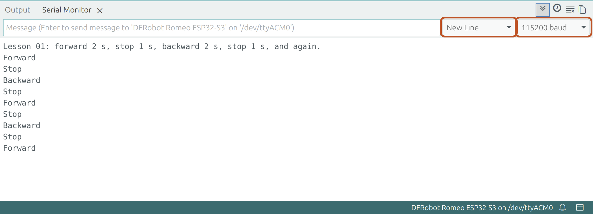

# Software setup

This page prepares a computer to program Mini Omni Bot and confirms the setup by running the
first lesson on the robot.

**Objectives**

- Install the Arduino IDE 2 and the ESP32 board package.
- Select the board, settings and port for the Romeo ESP32-S3.
- Upload a program and read its messages in the Serial Monitor.
- Use [PlatformIO in VS Code](#alternative-platformio-in-vs-code) as an alternative.

## You will need

| Item | Notes |
|------|-------|
| A computer | Windows 10 or 11, macOS or Linux, with internet access |
| A USB-C data cable | Some cables carry power only. |
| The wired robot, a charged battery and a small box | From [Assembly](02_Assembly.md); the box raises the wheels |

## 1. Download the project files

Open https://github.com/LazarevMike/Mini_Omni_Bot, select **Code > Download ZIP**, and unzip the file into a new, empty folder
such as Documents (or run `git clone https://github.com/LazarevMike/Mini_Omni_Bot`). This **project folder** contains
`firmware`, `docs` and `platformio.ini`. The tools cannot build from inside a ZIP file.

## 2. Install the Arduino IDE 2 and the ESP32 boards

An **IDE** (integrated development environment) is a program for writing, building and
uploading code; a **board package** adds support for a family of boards.

1. Install Arduino IDE 2 from [arduino.cc/en/software](https://www.arduino.cc/en/software).
2. Open **File > Preferences** (macOS: **Arduino IDE > Settings**), enter this address in
   **Additional boards manager URLs**, and click **OK**:

   ```text
   https://espressif.github.io/arduino-esp32/package_esp32_index.json
   ```

3. Open **Tools > Board > Boards Manager** and search for `esp32`. Under **esp32 by Espressif
   Systems**, select version **2.0.17**, the tested version, and click **Install**. After
   several minutes, **INSTALLED** appears next to the package.

## 3. Connect the robot

Connect the USB-C cable between the board and the computer, and switch SW on.

## 4. Select the board, settings and port

Set the **Tools** menu as in the table, leaving every other setting at its default. The
**port** is the connection through which the computer reaches the board; if several are listed,
unplug the robot and note which one disappears.

| Setting | Value |
|---------|-------|
| Board (under **esp32**) | DFRobot Romeo ESP32-S3 |
| USB CDC On Boot | Enabled |
| USB Mode | Hardware CDC and JTAG |
| Port | Windows: `COM3` or similar. macOS: `/dev/cu.usbmodem...`. Linux: `/dev/ttyACM0` |

**USB CDC On Boot** (CDC: Communications Device Class) sends the program's messages through the
ESP32-S3's built-in USB port; on Disabled, the Serial Monitor stays blank.

## 5. Upload lesson 01

> [!WARNING]
> Lesson 01 starts the M1 motor 3 s after the upload. If the wheels touch the table, the robot
> can drive off the edge.

1. Open **File > Open** and select `firmware/lessons/01_Spin_One_Motor/01_Spin_One_Motor.ino`.
   A **sketch** is an Arduino program, stored as an `.ino` file in a folder of the same name.
   Check that the board and port in the new window are still correct.
2. Stand the robot on the box with all three wheels clear of the table. Switch SW off, connect
   the battery, and switch SW on. USB power alone cannot drive the motors.
3. Click **Upload** (the arrow at the top left). The IDE **compiles** the sketch (translates it
   into instructions for the chip) and **uploads** it (transfers it to the board). **Done
   uploading.** appears when it is complete.

## 6. Open the Serial Monitor



Example layout; the output was not captured from a robot.

The **Serial Monitor** is the IDE's text window for messages from the board and commands to
it. Open **Tools > Serial Monitor** and select **New Line** and **115200 baud**; the **baud
rate** is the speed of the serial link.

The M1 wheel now turns forward, stops, turns backward, stops, and repeats, while the Serial
Monitor prints `Forward`, `Stop`, `Backward` and `Stop`. Afterwards, switch SW off and
disconnect the battery.

> [!NOTE]
> **Key idea:** the **line ending** is the character the Serial Monitor adds when Enter is
> pressed. The robot runs a typed command only when the line ending arrives, so **No Line
> Ending** never works; **New Line**, **Carriage Return** and **Both NL & CR** all work.

## Alternative: PlatformIO in VS Code

**PlatformIO** is a VS Code extension that builds and uploads programs for microcontroller
boards, with its settings in `platformio.ini`.

1. Install VS Code from [code.visualstudio.com](https://code.visualstudio.com/), then the
   **PlatformIO IDE** extension from the Extensions view.
2. Open **File > Open Folder** and select the project folder. Trust the authors when asked. On
   first use, PlatformIO downloads the ESP32 tools.
3. The bar along the bottom shows the **environment**, a named set of build settings;
   **Default** is the Romeo.
4. Prepare the robot as in section 5, step 2. Open **New Terminal** in the bottom bar and run
   `PLATFORMIO_SRC_DIR=firmware/lessons/01_Spin_One_Motor pio run -t upload` (Windows
   PowerShell: run `$env:PLATFORMIO_SRC_DIR="firmware/lessons/01_Spin_One_Motor"`, then
   `pio run -t upload`). The output ends with `[SUCCESS]`.
5. Click **Serial Monitor** (the plug icon) in the bottom bar. Lesson 01 runs as described in
   section 6.

Close the Serial Monitor with **Ctrl+C** before the next upload, because it holds the port.
Close the terminal used for a lesson afterwards; the **Upload** button (→) then builds the full
program.

## Operating system notes

| System | Problem | Solution |
|--------|---------|----------|
| Linux | `Permission denied` on the port | Run `sudo usermod -aG dialout,plugdev $USER`, then log out and back in. Omit a group that does not exist. |
| Linux | Port busy just after a reset | ModemManager is testing the port. Wait a few seconds. |
| Windows | No COM port | No driver is needed on Windows 10 or 11. Check **Ports (COM & LPT)** in Device Manager. |
| macOS | A request to allow the accessory to connect | Click **Allow**. |

## If it doesn't work

| Symptom | Likely cause | Fix |
|---------|--------------|-----|
| No port is listed | SW is off, or a power-only cable | Switch SW on. Try another cable and USB socket. |
| The upload fails (`Failed to connect`, port busy) | A Serial Monitor holds the port | Close every Serial Monitor. If it still fails, hold BOOT, press and release RST, release BOOT, upload, then press RST. |
| The Serial Monitor stays blank | **USB CDC On Boot** is Disabled, or an encoder wire holds IO0 low | Set it to **Enabled** and upload again; move the wire to its pin ([Wiring, step 4](03_Wiring.md#4-connect-the-encoders)) and press RST. |

## Summary

- The Arduino IDE 2 with ESP32 board package 2.0.17 compiles and uploads the programs.
- The Romeo needs **DFRobot Romeo ESP32-S3**, **USB CDC On Boot: Enabled** and its port.
- The Serial Monitor runs at 115200 baud with the line ending **New Line**.
- PlatformIO takes the same settings from `platformio.ini`.

**Next:** [Lesson 01: Spin one motor](../firmware/lessons/01_Spin_One_Motor/README.md)
explains the program that is now running.
