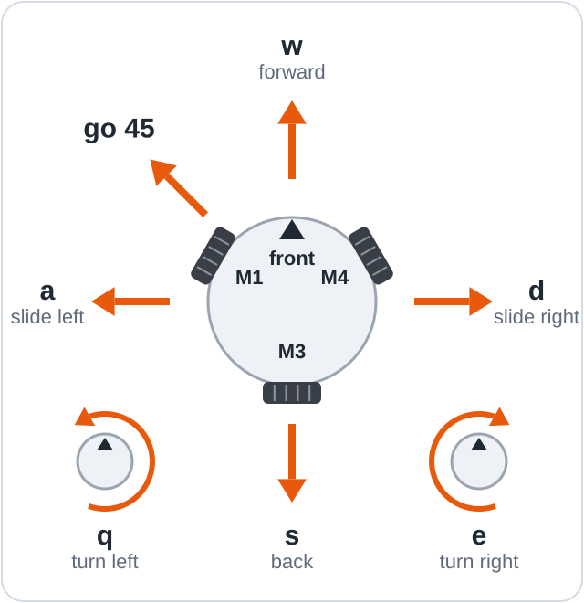
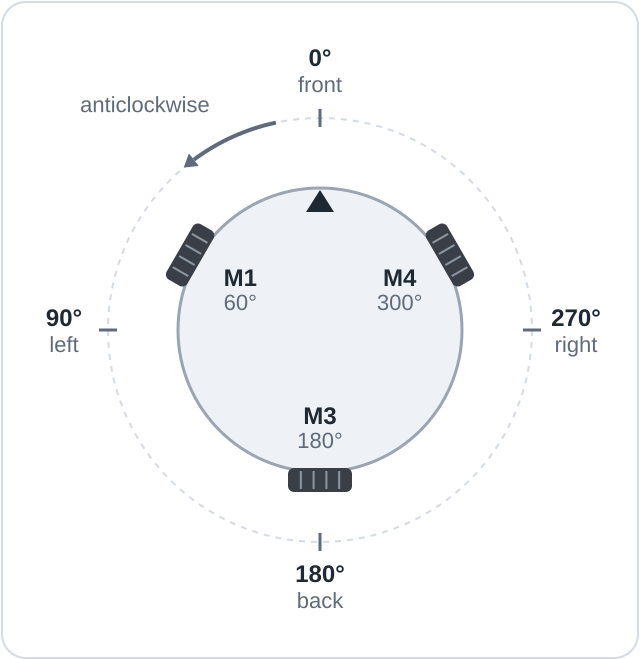

# First drive

This page installs the full program on Mini Omni Bot, tests every motor and encoder, and
calibrates the robot so that it moves in the commanded direction.

**Objectives**

- Stop the robot at any moment from the Serial Monitor.
- Upload the full program and control the robot with typed commands.
- Verify each motor and encoder with the motor test.
- Calibrate the wheel settings in `config.h`.

## You will need

| Item | Notes |
|------|-------|
| The wired robot and a charged 12 V battery | For example a 3S LiPo (11.1 V) |
| A computer set up as in [Software setup](04_Software_Setup.md) | With a USB-C data cable |
| The wheel settings from [lesson 03](../firmware/lessons/03_Find_Your_Wheels/README.md) | Used in section 2 |
| A small box, and 1 m × 1 m of clear floor | For the test and the first moves |

## 1. Learn the stop keys

With the Serial Monitor's line ending on **New Line**, each of these actions stops the robot
immediately:

| Action | Result |
|--------|--------|
| Press Enter on an empty line (the quickest method), or type `x` and press Enter | Stops the robot |
| Send any line that is not a valid command | Stops the robot and prints the reason |
| Switch SW off | Removes power from the controller, even with USB connected |

> [!CAUTION]
> Disconnecting the USB cable does not stop the robot, because the battery keeps it running.
> Switch SW off instead, and keep fingers and hair clear of turning wheels.

## 2. Upload the full program

The **full program** in `firmware/OmniBots_Mini/` combines typed commands, the motor test and
the [phone joystick](06_Phone_Joystick.md). Its settings are in `config.h`, which the Arduino
IDE shows as a tab above the editor.

1. Connect the robot by USB and switch SW on. The battery is not needed yet.
2. Open `firmware/OmniBots_Mini/OmniBots_Mini.ino` in the Arduino IDE, or the project folder
   in PlatformIO.
3. Enter the wheel settings from lesson 03 into `WHEEL_SETUP` in `config.h`
   ([section 6](#6-calibrate-the-wheel-settings)), changing only the values, and save.
4. Check the Tools settings as in
   [Software setup](04_Software_Setup.md#4-select-the-board-settings-and-port) and click
   **Upload**. The upload ends with **Done uploading.** (PlatformIO: `[SUCCESS]`).

## 3. Open the Serial Monitor and type help

1. Open the Serial Monitor at 115200 baud with the line ending **New Line**. The window stays
   blank, because the program prints nothing until it receives a command.
2. Type `help` and press Enter.

The robot prints its list of commands, beginning with
`Commands - type one, then press Enter. [speed] in %, [time] in ms` and ending with
`(this program is set up for: Romeo ESP32-S3)`. In PlatformIO each command appears twice: as
typed, and as echoed by the robot.

## 4. Run the motor test with the wheels raised

The **motor test** spins each motor alone, forward and then backward, at 25% power, and checks
that its **encoder**, the sensor that reports the motor's rotation, counts in the same
direction.

> [!WARNING]
> If the wheels touch the table, the test drives the robot, which can fall off the edge.

1. Stand the robot on the box with all three wheels clear of the table.
2. Switch SW off, connect the battery, and switch SW on.
3. Type `test` and press Enter. The test takes about 7 s; pressing Enter aborts it.

In a correct result, each `+` line shows a positive count and each `-` line a negative count,
with no warning at the end. The numbers vary from robot to robot.

```text
test
   test: each motor alone at +25% then -25% for 800 ms, Enter aborts
  M1 +25%   +1747 counts  +1.17 turns
  M1 -25%   -1747 counts  -1.17 turns
  M3 +25%   +1747 counts  +1.17 turns
  M3 -25%   -1747 counts  -1.17 turns
  M4 +25%   +1747 counts  +1.17 turns
  M4 -25%   -1747 counts  -1.17 turns
   test done
```

| Warning | Meaning and action |
|---------|--------------------|
| `<- counts backwards: swap A/B or set flipEncoder to true in config.h` | The encoder counts the opposite way. Correct it in [section 6](#6-calibrate-the-wheel-settings). |
| `<- no pulses: check encoder A/B, its power and GND, and the battery` | The encoder counted fewer than 20. If the wheel did not turn, check the battery, SW and the PMODE jumper; if it did, check the encoder wires ([Wiring](03_Wiring.md)). |

## 5. Make the first moves on the floor



The front of the robot is the side between M1 and M4. Each move runs at 30% for 1 s. Place the
robot on the floor with the USB cable slack.

1. Type `q`. The robot turns anticlockwise on the spot, seen from above. It does not travel,
   which makes this the safest first move.
2. Type `w`. The robot drives towards its front.
3. Try `s`, `a`, `d`, `e` and `go 45`, then `w 50 2000` (forward at 50% for 2 s).

Each move reports when it starts and how far each wheel turned when it ends, as in this example:

```text
w
-> forward 30% for 1000 ms
   done      M1 -2534  M3 +0  M4 +2533 counts
```

During `w`, M3 barely turns: the back wheel lies at right angles to the travel, so its free
rollers roll along while it stays still ([How it works](07_How_It_Works.md)).

## 6. Calibrate the wheel settings



**Calibration** matches the program's wheel settings to the real robot. `WHEEL_SETUP` in
`config.h` has one line per wheel, in the order M1, M3, M4; the values shown are those of the
reference robot.

```cpp
const WheelSetup WHEEL_SETUP[3] = {
  // angle   flipMotor   flipEncoder
  {    60,   false,      true },   // front left
  {   180,   false,      true },   // back
  {   300,   false,      true },   // front right
};
```

`angle` is the wheel's position in degrees, anticlockwise from the front (90 is left).
`flipMotor` reverses the motor and `flipEncoder` reverses the encoder count. Work through the
checks in order, uploading after each change.

> [!NOTE]
> **Key idea:** correct the motor directions before the encoder directions, because reversing
> a motor also reverses the sign of its encoder count.

| Observation | Fix |
|-------------|-----|
| `q` turns clockwise | Change `flipMotor` on all three lines. |
| `q` wobbles instead of turning on the spot | Send `m1 30`, `m3 30` and `m4 30` in turn; each should swing the robot anticlockwise. Change `flipMotor` for the one that does not. |
| `w` does not go forward, or `a` does not slide left | Follow each cable from M1, M3 and M4 to its wheel and correct that line's `angle`. |
| `test` reports `counts backwards` | Change `flipEncoder` for that wheel. |

The calibration is complete when `q` turns anticlockwise on the spot, `w` drives forward, `a`
slides left, and `test` shows no warnings.

## Command reference

`[speed]` is a percentage of full power and `[time]` is in milliseconds; the defaults are 30%
and 1000 ms. Arguments must be plain numbers: `w 50%` stops the robot and prints
`'50%' is not a number - type help`.

| Command | Action |
|---------|--------|
| `w`, `s` `[speed] [time]` | Drive forward, backward |
| `a`, `d` `[speed] [time]` | Slide left, right |
| `q`, `e` `[speed] [time]` | Turn anticlockwise, clockwise on the spot |
| `go <angle> [speed] [time]` | Drive at an angle: 0 front, 90 left, 180 back, 270 right |
| `m1`, `m3`, `m4` `<power> [time]` | Run one motor alone, power -100 to 100 |
| Enter on an empty line, or `x` | Stop now |
| `speed <0-100>`, `time <ms>` | Set the default speed or move time (`time 0`: until stopped) |
| `enc`, `zero` | Show encoder counts, turns and rpm; reset the counts |
| `test` | Run the motor test |
| `wifi`, `wifi <name> <password>`, `wifi off` | Show the WiFi status; join a home network; return to the hotspot ([Phone joystick](06_Phone_Joystick.md#2-read-the-hotspot-name-and-password)) |
| `help` | List the commands |

## If it doesn't work

| Symptom | Likely cause | Fix |
|---------|--------------|-----|
| The robot prints `(that line came without a line ending, so it won't run: ...)` | The line ending is **No Line Ending** | Select **New Line** and send the command again. |
| The upload fails, or the port is busy | A Serial Monitor holds the port | Close it and upload again ([Software setup](04_Software_Setup.md#if-it-doesnt-work)). |
| A wheel turns the wrong way | A `flipMotor` setting | Follow [section 6](#6-calibrate-the-wheel-settings). |

## Summary

- Enter on an empty line, `x` or any invalid line stops the robot; SW off switches the
  controller off, but the battery stays connected.
- The full program stays silent until it receives a command; `help` lists the commands.
- The motor test checks every motor and encoder with the wheels raised.
- `WHEEL_SETUP` in `config.h` holds each wheel's angle and directions; motors are corrected
  before encoders.

**Next:** [Phone joystick](06_Phone_Joystick.md): drive the robot from a phone.
