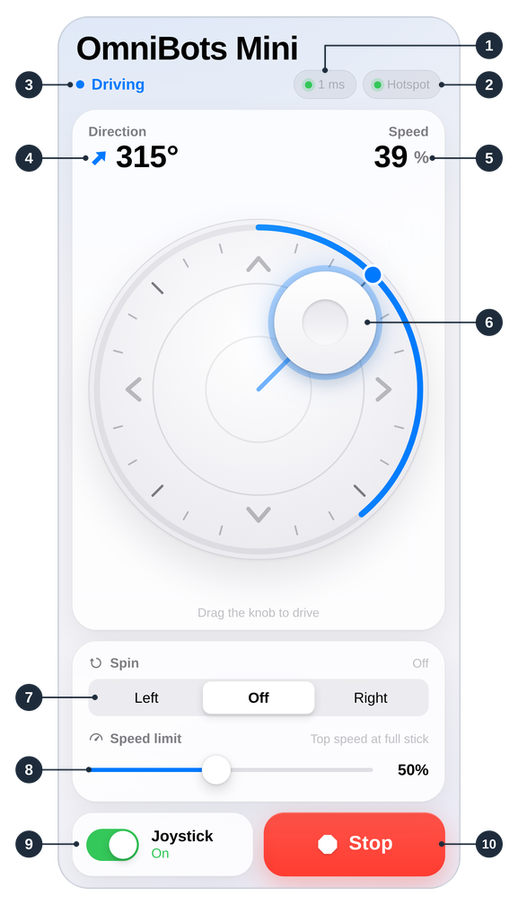

# Phone joystick

This page shows how to drive Mini Omni Bot from a phone's web browser.

**Objectives**

- Connect a phone to the robot's WiFi hotspot.
- Open the driving page and enable Joystick mode.
- Identify each control on the driving page.

The **phone joystick** is the part of the full program that lets a phone drive the robot: the
robot creates its own WiFi network, a **hotspot**, and serves the **driving page** to any device
that joins it. It is on by default; setting `REMOTE_CONTROL` to 0 in `config.h` removes it.

## You will need

| Item | Notes |
|------|-------|
| Mini Omni Bot running the full program, with a charged battery | See [First drive](05_First_Drive.md) |
| A phone or tablet with WiFi and a web browser | A computer also works |
| The USB cable and the Serial Monitor | Once, to read the password |
| About 2 m of clear floor on every side | |

## 1. Check the antenna

The Romeo's WiFi module has no built-in antenna. Check that the antenna is clipped on
([Assembly, step 10](02_Assembly.md#10-fit-the-antenna)); without it, the hotspot has a very
short range.

## 2. Read the hotspot name and password

Switch SW off, connect the battery, and switch SW on. Connect the USB cable, open the Serial
Monitor and type `wifi`. The robot prints the hotspot name, its password and the driving
page's address ("web joystick"):

```text
wifi
   wifi: hotspot OmniBots_Mini, password 7hk3mzq2pa
   web joystick: http://192.168.4.1
```

Each robot generates its own password when first started and keeps it. Where several robots
share a room, give each a different `HOTSPOT_NAME` in `config.h`.

The command `wifi <name> <password>` makes the robot join a home network instead and saves the
setting on the robot; `wifi` then prints the driving page's new address, and `wifi off` returns
the robot to its hotspot.

> [!TIP]
> Write the password on a label under the robot; no computer is then needed.

## 3. Join the hotspot

In the phone's WiFi settings, select `OmniBots_Mini` and enter the password. If the phone warns
that the network has no internet access, choose to stay connected.

## 4. Open the driving page

In the phone's browser, type the full address **http://192.168.4.1**, including `http://`.
The first chip at the top (**Robot** on a wide screen) turns green, and the status line reads "Joystick mode is off".

## 5. Drive

> [!WARNING]
> The robot cannot detect table edges or stairs. Drive it on the floor only.

1. Disconnect the USB cable and place the robot on the floor.
2. Tap the **Joystick** switch. The padlock on the pad disappears.
3. Drag the knob. The robot moves in that direction; the top of the pad is the robot's front.
4. Release the knob to stop, or tap **Stop** to brake immediately.

> [!NOTE]
> **Key idea:** the driving page sends a message 10 to 20 times per second. If half a second
> passes without one, the robot stops by itself.

## 6. The driving page controls



| # | Control | What it does |
|---|---------|--------------|
| 1 | Robot chip (the first chip) | Link to the robot: green connected, orange connecting, red lost or another device in control; the number is the round-trip time in ms |
| 2 | WiFi chip | The robot's WiFi; reads **Hotspot** on the hotspot |
| 3 | Status line | The current state, for example "Ready to drive" or "Driving" |
| 4 | Direction | Direction of travel, anticlockwise from the front: knob left is 90°, knob right 270° |
| 5 | Speed | Present speed, as a percentage of top speed |
| 6 | Knob | Drives the robot; further from the centre is faster |
| 7 | Spin: Left / Off / Right | Turns the robot (Left is anticlockwise) until Off or Stop; combines with the knob |
| 8 | Speed limit | Speed at full knob travel and for turning, 10 to 100%; 50% on first use, then the last setting |
| 9 | Joystick switch | Enables the knob and Spin; off when the page opens, and turned off by any move or stop command typed in the Serial Monitor |
| 10 | Stop | Brakes immediately and cancels Spin; Joystick mode stays on |

## If it doesn't work

| Symptom | Likely cause | Fix |
|---------|--------------|-----|
| `OmniBots_Mini` is not in the WiFi list | Antenna not connected, or the robot set to join a home network | Clip the antenna on. Type `wifi`; if it names another network, type `wifi off`. |
| The page does not load | Incomplete address, or the phone has left the hotspot | Type `http://192.168.4.1` in full. Check that the phone is still on `OmniBots_Mini`, or turn mobile data off. |
| "Another device is in control" | The page is open on another phone, computer or tab | Close it there. A page that is silent for 6 seconds loses control. |

## Summary

- The robot creates its own hotspot and serves the driving page; no app or internet is needed.
- The `wifi` command prints the hotspot name, password and page address.
- The knob and Spin work only while Joystick mode is on.
- The robot stops if the page is silent for half a second.

**Next:** [How it works](07_How_It_Works.md): the mathematics and electronics behind the robot.
