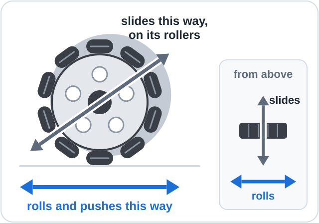
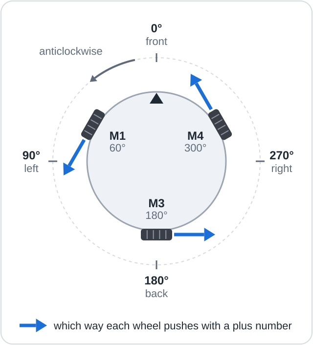
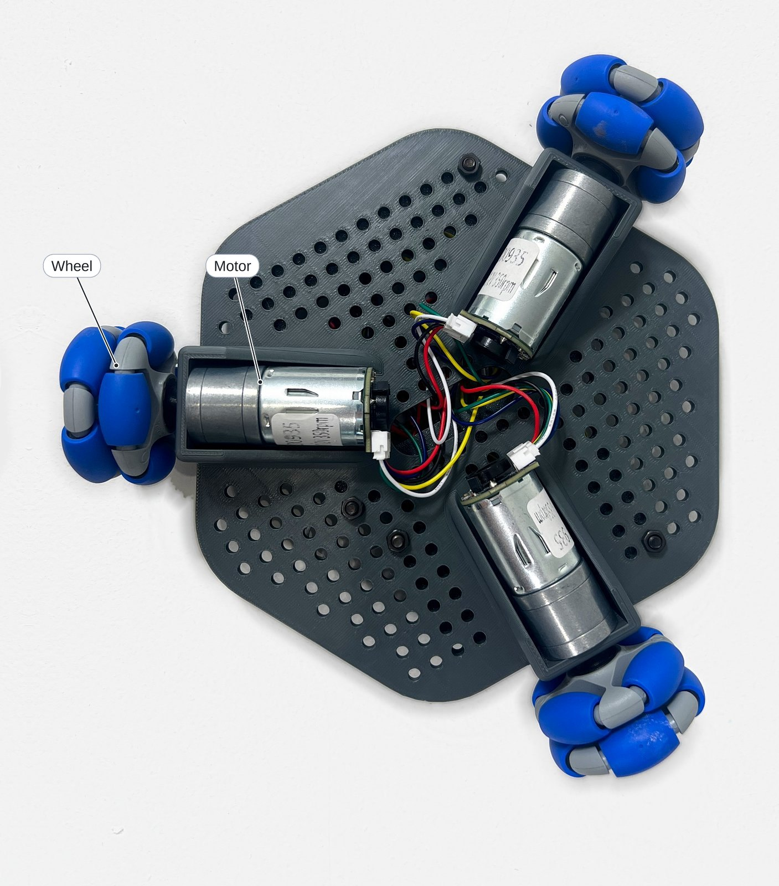
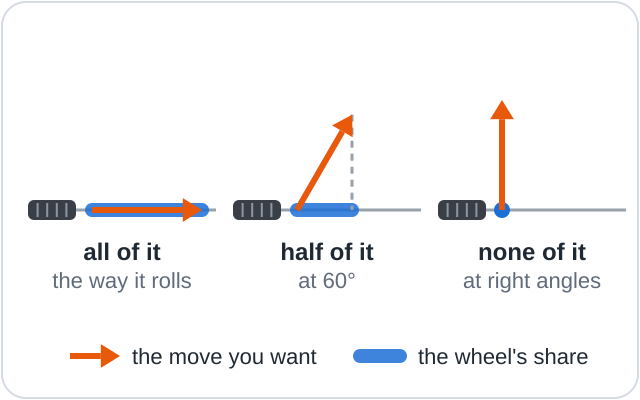
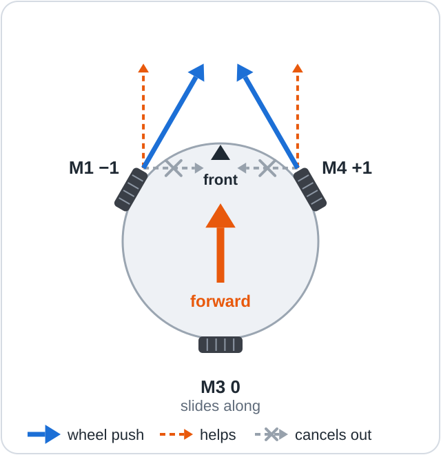
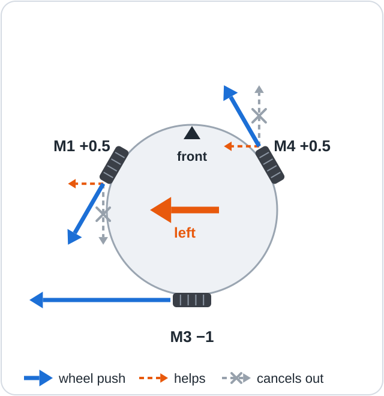
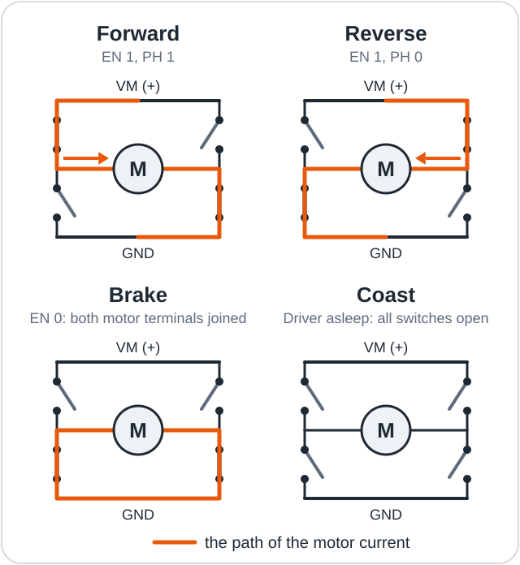
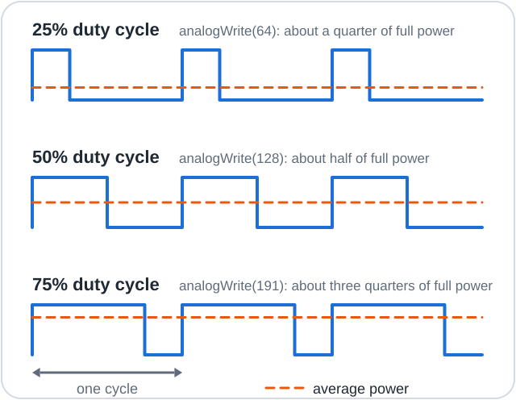
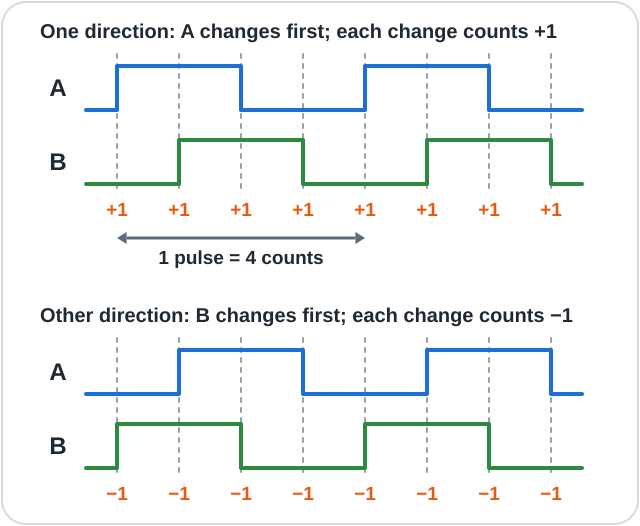

# How it works

This page explains the principles that let Mini Omni Bot drive in any direction.

**Objectives**

- Explain how an omni wheel rolls in one direction and slides in another.
- Calculate each wheel's power for a requested move with the wheel formula.
- Describe how an H-bridge and PWM control a motor's direction and speed.
- Explain how an encoder measures a wheel's direction and speed.

Lessons [01](../firmware/lessons/01_Spin_One_Motor/README.md),
[02](../firmware/lessons/02_Count_Wheel_Turns/README.md) and
[04](../firmware/lessons/04_Drive_Any_Direction/README.md) apply these ideas in code.

## 1. Omni wheels



An **omni wheel** is a wheel with small free-turning rollers around its rim, whose axles lie at
right angles to the wheel's own axle. It **rolls** like an ordinary wheel when the motor turns
it, and pushes the robot; it **slides** along its axle, because the rollers turn freely.

> [!NOTE]
> **Key idea:** each omni wheel pushes along one line only and slides freely across it. The
> robot's motion is the sum of the three pushes.

## 2. Three wheels, 120° apart





Angles are measured anticlockwise from the front, seen from above: M1 is at 60° (front left),
M3 at 180° (back) and M4 at 300° (front right). A **kiwi drive** is a layout of three omni
wheels spaced evenly, 120° apart, around the centre. Each wheel rolls around the centre, not
towards it, so when all three receive a positive power they all push the robot anticlockwise
(the blue arrows).

## 3. One formula for every direction



Represent the requested move as an arrow and a wheel's rolling direction as a line. The
**projection** of the arrow onto the line is the part of the move that lies along it, like the
shadow the arrow casts on the line. It is the speed at which that wheel must roll: all of the
move along the line, none at right angles (the wheel slides), and the cosine of the angle in
between, for example 0.87 at 30° and 0.5 at 60°.

> [!NOTE]
> **Key idea:** each wheel's power is the projection of the requested move onto that wheel's
> rolling direction.

A wheel at `angle` pushes the robot along (-sin(angle), cos(angle)), a forward part and a left
part. Multiplying each part by the move and adding the results gives the projection:

```text
wheel power = -sin(angle) × forward + cos(angle) × left
```

`forward` and `left` are the parts of the requested move; negative values mean back or right.
The formula works for any wheel angles set in `WHEEL_SETUP` in
[config.h](../firmware/OmniBots_Mini/config.h), provided all wheels are the same distance from
the centre.

### Going forward



With `forward` = 1 and `left` = 0:

| Wheel | -sin(angle) | Scaled | Pushes the robot |
|-------|-------------|--------|------------------|
| M1 (60°) | -0.87 | -1 | forward and slightly right |
| M3 (180°) | 0 | 0 | not at all; it slides |
| M4 (300°) | +0.87 | +1 | forward and slightly left |

A negative value turns the wheel backwards, so M1 pushes opposite to its arrow in section 2.
Each front wheel's line is 30° from forward, so its share is cos 30° = 0.87; the sideways parts
cancel and the forward parts add. The code scales all three values so that the busiest wheel
receives exactly the requested speed: `w 100` gives -1, 0, +1, and `w 50` gives -0.5, 0, +0.5.

### Sliding left



With `forward` = 0 and `left` = 1, the formula gives M1 +0.5, M3 -1 and M4 +0.5: the rear wheel
rolls directly left and receives the whole move, and each front wheel, 60° from left, receives
half.

### Turning, and turning while driving

To turn on the spot, all three wheels receive the same value: a positive value turns the robot
anticlockwise (`q`), a negative value clockwise (`e`). To drive and turn together, the code
adds the turn value to every wheel after scaling. If any wheel then exceeds 1 (full power), all
three are divided by the largest value, so the robot follows the same curve more slowly. For
example, full speed forward (-1, 0, +1) with a turn of 0.5 gives -0.5, +0.5, +1.5; dividing by
1.5 gives M1 -0.33, M3 +0.33, M4 +1.

## 4. Motor drivers: H-bridges and PWM

A **motor driver** is a circuit that switches battery power to a motor on command from the
microcontroller, because a motor draws far more current than a pin can supply and must run in
both directions. The Romeo has four built-in drivers (DRV8876 chips), one per motor socket.

### Which way: the H-bridge



An **H-bridge** is four electronic switches arranged around a motor in the shape of the letter
H. Closing the top-left and bottom-right switches drives current through the motor one way;
closing the other pair reverses the current and the motor's direction. The driver chip never
closes both switches on one side, which would short-circuit the battery.

The Romeo's PMODE jumper sets its drivers to PH/EN mode: PH (phase) selects the direction and
EN (enable) switches the motor on.

| EN | PH | The motor |
|----|----|-----------|
| 0 | either | brakes |
| 1 | 1 | turns forward |
| 1 | 0 | turns in reverse |

**Braking** joins the two motor terminals; the spinning motor then acts as a generator that
opposes its own rotation, so it stops quickly. **Coasting** disconnects both terminals and lets
the motor slow down by friction. The program always brakes to stop a motor.

### How fast: PWM



**Pulse-width modulation (PWM)** controls average power by switching a signal fully on and off
rapidly. The fraction of each cycle that the signal is on is the **duty cycle**. The motor
cannot follow individual pulses, so it runs at roughly the average power: 30% power means EN is
on for 30% of each cycle. The Arduino function `analogWrite()` takes a value from 0 to 255, so 64
gives about 25%. Very low settings may not overcome friction and turn the wheel.

The full program switches at 20 kHz (`MOTOR_PWM_HZ` in `config.h`), at or above the limit of
human hearing, so the motors are silent.

## 5. Counting wheel turns: encoders



An **encoder** is a sensor that produces pulses as a shaft turns. Each motor has one at its rear:
a magnetic disc on the shaft and two **hall sensors**, which switch between high and low as the
magnetic poles pass. They produce two square waves, A and B, a quarter of a cycle apart. This
arrangement is called **quadrature**: in one direction A changes first, in the other B does.

> [!NOTE]
> **Key idea:** the order of the changes gives the direction of rotation, and their number gives
> the distance turned.

Each wave has a rising and a falling edge per cycle, so each pulse produces four changes, and
the program counts all four:

```text
11 pulses per motor turn × 34 (gearbox ratio) × 4 edges = 1496 counts per wheel turn
```

This is `COUNTS_PER_WHEEL_TURN` in `config.h`. At full speed a wheel produces about 8700
counts per second, too many to check from the main program. Instead, each change on A or B
triggers an **interrupt**: the processor pauses, runs a short function that adds or subtracts
one ([lesson 02](../firmware/lessons/02_Count_Wheel_Turns/README.md)), then resumes.

Every 0.1 s the program measures how far each wheel's count has changed. For example, 150
counts in 0.1 s is a tenth of a turn in a tenth of a second, which is 60 rpm.

## Summary

- An omni wheel pushes along its rolling direction and slides along its axle.
- Three omni wheels 120° apart (a kiwi drive) can move the robot in any direction and turn it.
- Each wheel's power is -sin(angle) × forward + cos(angle) × left, scaled, plus the turn value.
- An H-bridge sets a motor's direction; PWM sets its average power.
- A quadrature encoder gives 1496 counts per wheel turn and the direction of rotation.

**Next:** [Other boards](08_Other_Boards.md): running the robot on another controller.
