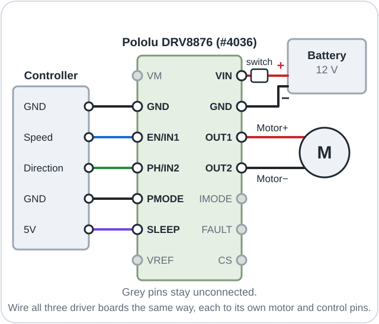

# Other boards

This page explains how to run Mini Omni Bot on a controller board other than the DFRobot Romeo
ESP32-S3, using separate motor driver boards.

**Objectives**

- Identify how far each board has been tested and which features it offers.
- Select a motor driver that suits the 12 V FIT0493 motors.
- Connect DRV8876 driver boards to a controller board.
- Configure the program for a listed board or for your own.

## You will need

| Item | Notes |
|------|-------|
| A controller board and 3 × Pololu DRV8876 boards ([#4036](https://www.pololu.com/product/4036)) | One driver per motor, header pins soldered on |
| Jumper wires and a small breadboard | For the connections |
| A switch or plug in the battery + lead | These boards have no SW power switch |
| A USB cable | Powers the controller board; battery power for it is not yet documented |

## Board status

Every board except the Romeo needs a separate **motor driver**, a circuit that switches battery
current through a motor on command from the board's signals.

| Board | Status | Phone joystick | Logic voltage |
|-------|--------|----------------|---------------|
| DFRobot Romeo ESP32-S3 | Tested | yes | 3.3 V |
| ESP32-S3 DevKitC-1 | Builds | yes | 3.3 V |
| Arduino UNO R4 Minima or WiFi | Builds | no | 5 V |
| Your own board | Untested | ESP32 boards only | that of the board |

**Tested** means driven on a real robot; **Builds** means compiled, with every pin checked
against the board's pin list, but not yet driven. The phone joystick needs an ESP32; on other
boards the robot is driven from the Serial Monitor.

`boards.h` also holds compile-checked presets for the ESP32 DevKit, the Arduino Mega 2560 and
the STM32 Nucleo-F401RE, with their wiring in its comments. The classic Arduino Uno R3 has too
little memory for the full program but runs the [lessons](../firmware/lessons/README.md):
connect the drivers' EN inputs to pins 9, 10 and 11, their PH inputs to 4, 6 and 8, and W1's
encoder to 2 and 3, powered from 5V; in lesson 03, set W2's and W3's encoder pins to A0 to A3
and ignore their counts.

## Motor driver styles

Drivers take their commands in one of three styles. Speed is always sent as **PWM**
(pulse-width modulation), rapid on-off switching whose on-time sets the power.

| `MOTOR_DRIVER` | pin1 | pin2 | pin3 | Typical drivers |
|----------------|------|------|------|-----------------|
| `DRIVER_PH_EN` | EN: speed | PH: direction | unused | DRV8876, DRV8874, Cytron MD10C and MDD10A |
| `DRIVER_IN1_IN2` | IN1: speed one way | IN2: speed the other way | unused | DRV8871, BTS7960 (R_EN, L_EN high) |
| `DRIVER_PWM_DIR` | PWM: speed | IN1: direction | IN2: direction | TB6612FNG, L298N (ENA, ENB jumpers removed) |

> [!NOTE]
> **Key idea:** every driver does the same job; only the meaning of its pins differs.
> `MOTOR_DRIVER` in `config.h` tells the program which pattern to produce. In all three styles
> a speed of 0 brakes the motor.

With `DRIVER_PWM_DIR`, connect each wheel's spare pin (pin3) to IN2; the lessons, which drive
only EN and PH, then also need an IN2 pin per wheel, set opposite to PH. `DRIVER_IN1_IN2` needs
two PWM pins per wheel, which only the ESP32 DevKit and ESP32-S3 DevKitC-1 presets provide.

## Choosing a driver for the FIT0493 motors

The FIT0493 draws up to 5.5 A when stalled, which no small driver supplies for long: never hold
a driven wheel still.

| Driver | Suitability for the 12 V FIT0493 |
|--------|----------------------------------|
| Pololu DRV8876 (#4036) | **Recommended.** The Romeo's own chip, same code; current limit about 2 A with SLEEP on 5V. The DRV8874 board (#4035) has the same pins and takes 2.1 A continuous. |
| DRV8871, L298N | Alternatives. The DRV8871 (for example Adafruit #3190) takes 6.5 to 45 V, with a current limit set by a resistor; the L298N works but drops about 2 V as heat. |
| TB6612FNG, DRV8833, DRV8835, L9110S | Unsuitable: the TB6612FNG is rated 1 A with no current limit; the others are rated at most 10.8 to 12 V, below a full 3S LiPo (12.6 V). |

## Wiring a DRV8876 board

> [!CAUTION]
> Unplugging the USB cable does not stop the motors: fit a switch or plug in the battery + lead.
> Connect PMODE to GND before the first power-up, with the wheels off the ground. The driver
> reads PMODE only at power-up; in any other mode a wheel turns the wrong way or far too fast.

Wire all three boards identically, using the pin names printed on them.

| DRV8876 pin | Connect to |
|-------------|------------|
| VIN | Battery +, through the switch or plug |
| GND | Battery −, and a GND pin on the controller board |
| OUT1, OUT2 | The motor's Motor+ and Motor− |
| EN/IN1, PH/IN2 | The wheel's Speed → EN and Direction → PH pins |
| PMODE | GND (selects PH/EN mode) |
| SLEEP | The controller board's 5V pin; unconnected, the driver stays asleep |
| VREF, IMODE, FAULT, CS, VM | Nothing |

> [!WARNING]
> On a 3.3 V board, never power the encoders from 5V: the pins are not 5 V tolerant.

Connect each encoder's Enc + to the board's **logic voltage**, the voltage its pins use for a
high signal, and Enc GND to GND. The DRV8876 suits 3.3 V and 5 V boards; SLEEP goes to 5V on
both, because it also sets the current limit.

## Picking your board

| Board | `config.h` line | Arduino IDE (Tools > Board) | PlatformIO environment |
|-------|-----------------|-----------------------------|------------------------|
| ESP32-S3 DevKitC-1 | `BOARD_ESP32S3_DEVKIT` | ESP32S3 Dev Module | `esp32s3_devkit` |
| UNO R4 | `BOARD_UNO_R4` | Arduino UNO R4 Minima / WiFi | `uno_r4_minima` / `uno_r4_wifi` |
| Your own | `BOARD_MY_OWN` | Your board | `my_own` |

In the Arduino IDE, leave exactly one board line in
[config.h](../firmware/OmniBots_Mini/config.h) without `//` and select the matching Tools >
Board. In PlatformIO, select the environment; the board lines in `config.h` are then ignored.
After uploading, the last line of `help` names the board, for example
`(this program is set up for: ESP32-S3 DevKitC-1)`. On these boards the wheels are W1 (front
left, 60°), W2 (back, 180°) and W3 (front right, 300°), and the one-motor commands are `w1`,
`w2` and `w3`.

## ESP32-S3 DevKitC-1 (`BOARD_ESP32S3_DEVKIT`)

This board and its clones (N8, N8R8, N16R8) have the Romeo's chip, so the phone joystick works.
The preset uses the Romeo's pins, except W3's speed pin: 14 instead of 47.

| Wheel | Speed → EN | Direction → PH | Encoder A | Encoder B | Spare (pin3) |
|-------|------------|----------------|-----------|-----------|--------------|
| W1 | 12 | 13 | 4 | 5 | 17 |
| W2 | 9 | 10 | 6 | 7 | 18 |
| W3 | 14 | 11 | 15 | 16 | 8 |

- All pins are on header J1; leave its pins 3 and 46 unconnected. Encoders take 3V3.
- Use the USB port marked UART (COM on some clones) with Tools > USB CDC On Boot on Disabled.
  For the port marked USB, or a board with only that port, set it to Enabled (PlatformIO:
  `-DARDUINO_USB_CDC_ON_BOOT=1`); otherwise the Serial Monitor stays blank.
- In lessons 03 to 05, M4's EN pin 47 becomes 14.

## Arduino UNO R4 Minima and WiFi (`BOARD_UNO_R4`)

Both boards share one preset. The logic voltage is 5 V, so the encoders take 5V.

| Wheel | Speed → EN | Direction → PH | Encoder A | Encoder B | Spare (pin3) |
|-------|------------|----------------|-----------|-----------|--------------|
| W1 | 3 | 4 | 2 | 8 | 10 |
| W2 | 5 | 7 | 12 | A1 | 11 |
| W3 | 6 | 9 | A2 | A3 | A0 |

- The six encoder pins sit on six separate interrupt channels, which the R4 requires.
- PWM runs at about 490 Hz instead of 20 kHz, so the motors whine faintly; this is harmless.
- The R4 WiFi has no phone joystick: its ESP32-S3 is only the WiFi modem and USB link. Never
  upload a program to that ESP32-S3, because it would lose its USB link.
- Install the "Arduino UNO R4 Boards" package in the Boards Manager. The lessons build for the
  R4 once these pins are typed into each sketch.

## Your own board

1. In [config.h](../firmware/OmniBots_Mini/config.h), remove the `//` in front of
   `#define BOARD_MY_OWN` and add one in front of the active board line. In PlatformIO, use the
   `my_own` environment, with its `platform` and `board` lines copied from the closest one.
2. Set `MOTOR_DRIVER` to the driver's [style](#motor-driver-styles).
3. Under "Your own board's pins", type each wheel's pins; `-1` means "not used". Speed pins
   must support PWM and encoder pins must be **interrupt pins**, whose changes the processor
   handles immediately; `DRIVER_PWM_DIR` also needs "direction 2". Use each pin once, and avoid
   strapping, USB, flash, LED and button pins.
4. Set `USE_ENCODERS` to 0 (and the encoder pins to `-1`) if they cannot all use interrupts.
5. Upload, lift the wheels off the ground, type `test`, then calibrate as in
   [First drive](05_First_Drive.md).

A required pin left at `-1` stops the build with a message. Working boards can be reported on the
[Issues page](https://github.com/LazarevMike/Mini_Omni_Bot/issues).

## If it doesn't work

| Symptom | Likely cause | Fix |
|---------|--------------|-----|
| No motor moves | SLEEP not on 5V, PMODE not on GND, battery not on VIN, or grounds not joined | Check each driver board; join all GND wires. |
| A wheel turns the wrong way or far too fast | PMODE was not on GND at power-up | Press Enter, disconnect the battery, connect PMODE to GND, reconnect. |
| Build stops at `config.h picks the ..., but Tools > Board (or platformio.ini) is another board` | `config.h` and Tools > Board differ | Select the same board in both. |

## Summary

- Only the Romeo is Tested; the other presets compile with checked pins.
- The Pololu DRV8876 board in PH/EN mode suits the 12 V FIT0493 motors.
- Every DRV8876 needs PMODE on GND and SLEEP on 5V; encoders take the logic voltage.
- `config.h` or the PlatformIO environment selects the board; another board needs
  `BOARD_MY_OWN`, `MOTOR_DRIVER` and a pin table.

**Next:** With a board other than the Romeo, upload the full program and calibrate it as in
[First drive](05_First_Drive.md).
