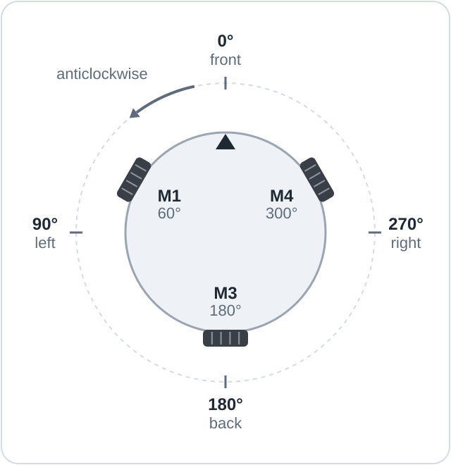
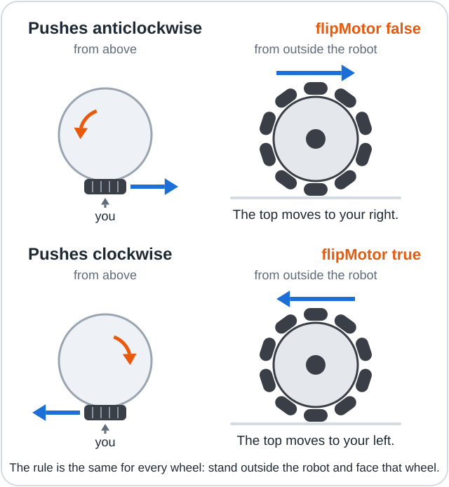

# Lesson 03: Find your wheels

Spin each motor on its own, observe where it sits and which way it pushes the robot, and turn
the observations into three wheel settings.

**Objectives**

- Drive any of the three motors through one function that takes a signed power.
- Identify each wheel's position (angle) on the robot.
- Determine each wheel's flipMotor and flipEncoder settings.

## You will need

The setup from [lesson 02](../02_Count_Wheel_Turns/README.md) with a charged battery, pen and
paper, and about 1 m of clear floor around the robot (a mug or box also works).

## Wiring



All three motors and encoders are connected as in [Wiring](../../../docs/03_Wiring.md); M2
stays empty. The drawing shows this **standard build**, the layout the full program expects by
default.

## The code

The sketch is [03_Find_Your_Wheels.ino](03_Find_Your_Wheels.ino).

### Key lines explained

```cpp
//                                M1    M3    M4
const int EN_PIN[3]        = {   12,    9,   47 };  // EN = speed (PWM), 0 = brake
const int PH_PIN[3]        = {   13,   10,   11 };  // PH = direction, HIGH = forward
```

An **array** is a list of values of one type, each reached by an index that starts at 0. Index
0 is M1, 1 is M3 and 2 is M4, so `EN_PIN[1]` is M3's EN pin, IO9.

```cpp
void setMotorPower(int wheel, int percent) {
  ...
  analogWrite(EN_PIN[wheel], abs(percent) * 255 / 100);  // 0..100% becomes 0..255
```

`setMotorPower` applies lesson 01's PH and EN control to any wheel, for a power from -100% to
100%: the sign sets PH, and the size, converted to 0 to 255, sets EN. The encoder counting is
lesson 02's, applied to six signals. `waitForGo()` ignores every typed character except `g`.

## Upload and run

> [!CAUTION]
> With the wheels in the air, keep fingers, hair and loose sleeves away from the spinning wheel.

1. Place the robot on the floor with about 1 m clear around it, or rest it on the mug or box.
   Switch SW off, connect the battery, then switch SW on.
2. Upload `03_Find_Your_Wheels.ino` and open the Serial Monitor (115200 baud, **New Line**), as
   in [lesson 01](../01_Spin_One_Motor/README.md#upload-and-run).
3. When the ready message appears, type `g` in the input box and press Enter.

## What you will see

Each wheel spins on its own at 25% for 1 s, and the robot prints how far every encoder counted.
On the standard build:

```text
Ready. Wheels lifted (or floor clear)? Type g and press Enter to start.

M1 on its own at 25% for 1000 ms. Where is it, and which way does it push?
  counted:   M1 -1630   M3 +2   M4 -1
  M1 counts DOWN, about 1.09 turns
...
Done. README.md in this lesson's folder turns your notes into settings.
```

M3 and M4 follow in the same form. The wheel that spun counts hundreds or more, the other two
almost nothing. Type `g` again to repeat the test.

## Record your wheel settings

Record three settings for each wheel.

**Angle.** A wheel's **angle** is its position, measured anticlockwise from the front of the
robot, seen from above: front 0, front left 60, back left 120, back 180, back right 240, front
right 300. Record where the wheel that spun actually sits.



**flipMotor.** On the floor, note which way the robot swings, seen from above. With the wheels in
the air, face the wheel from outside the robot: a top moving to your right pushes the robot
anticlockwise (`false`), to your left clockwise (`true`).

**flipEncoder.** Combine the push with the printed UP or DOWN:

| Pushed | Counted | flipMotor | flipEncoder |
|--------|---------|-----------|-------------|
| anticlockwise | UP | false | false |
| anticlockwise | DOWN | false | true |
| clockwise | DOWN | true | false |
| clockwise | UP | true | true |

When flipMotor is `true`, the program reverses the motor and, with it, the sign of its count.
For a wheel that pushed clockwise, DOWN therefore already agrees with the motor, and
flipEncoder stays `false`.

Lessons 04 and 05 use the angle and flipMotor values. The full program keeps all three in
`WHEEL_SETUP` in [config.h](../../OmniBots_Mini/config.h), which ships with the standard build:
angles 60, 180 and 300, flipMotor `false` and flipEncoder `true`.

## How it works

The program treats a positive power on any wheel as a push that turns the robot anticlockwise,
so turning on the spot is the same power on all three wheels. flipMotor corrects a motor wired
the other way round, and flipEncoder an encoder that counts the other way.

> [!NOTE]
> **Key idea:** the wheel settings describe the physical robot, so the same code drives any
> build correctly once its settings match.

## If it doesn't work

| Symptom | Likely cause | Fix |
|---------|--------------|-----|
| A wheel does not move | No motor power, loose motor wires, or (M1) a missing jumper | Check the battery, the socket's wires, and for M1 the M1EN and M1PH jumpers. |
| `hardly counted`, although the wheel turned | That wheel's encoder is not connected | Check its four encoder wires. |
| The count appears under another wheel | Two wheels' encoder wires are swapped | Move each encoder's wires to its own motor's pins. |

## Summary

- `setMotorPower(wheel, percent)` drives any wheel with a signed power.
- Each wheel is described by its angle, flipMotor and flipEncoder settings.
- The flip settings make positive power on every wheel push the robot anticlockwise.

**Next:** [Lesson 04: Drive any direction](../04_Drive_Any_Direction/README.md)
