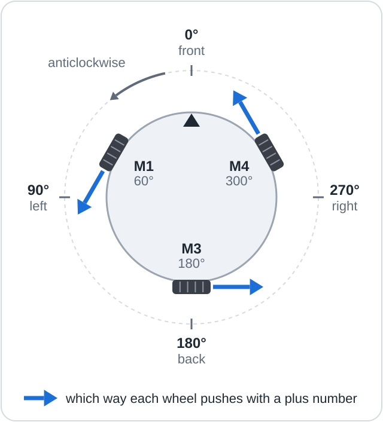

# Lesson 04: Drive any direction

Use one formula to drive the robot forward, sideways and diagonally, and to turn it on the spot.

**Objectives**

- Explain how an omni wheel pushes in one direction and slides freely in the other.
- Calculate each wheel's power for a requested motion.
- Scale the wheel powers so that the busiest wheel runs at a set speed.

## You will need

The setup from [lesson 03](../03_Find_Your_Wheels/README.md) with your notes, a mug or small
box, and about 1 m of clear floor all round the robot.

## Wiring

The wiring is the same as in [lesson 03](../03_Find_Your_Wheels/README.md#wiring). This lesson
does not read the encoders, but they can stay connected.

## The code

The sketch is [04_Drive_Any_Direction.ino](04_Drive_Any_Direction.ino).

### Key lines explained

```cpp
    float angle = radians(WHEEL_ANGLE[wheel]);  // sin() and cos() want radians, not degrees
    power[wheel] = -sin(angle) * forward + cos(angle) * left + turn;
```

`radians()` converts degrees into radians, the angle unit that `sin()` and `cos()` expect (180°
is π radians). `drive(forward, left, turn)` takes the requested motion, each part from -1 to 1:
`drive(1, 0, 0)` drives forward and `drive(0, 0, 1)` turns left on the spot. The second line is
the formula explained in [How it works](#how-it-works).

```cpp
      percent = round(power[wheel] / busiest * SPEED);
```

`busiest` is the largest power, ignoring sign, among the three wheels. Dividing by it and
multiplying by `SPEED` gives the busiest wheel exactly `SPEED`% and the others their share.
`setMotorPower()` then reverses any wheel marked `true` in `FLIP_MOTOR`.

## Upload and run

> [!CAUTION]
> From step 5 the robot moves across the floor. Keep 1 m clear all round it.

1. Open `04_Drive_Any_Direction.ino`, enter your angle and flipMotor values in `WHEEL_ANGLE` and
   `FLIP_MOTOR` (order M1, M3, M4), and save.
2. Rest the robot on the mug or box. Switch SW off, connect the battery, then switch SW on.
3. Upload the sketch and open the Serial Monitor (115200 baud, **New Line**), as in
   [lesson 01](../01_Spin_One_Motor/README.md#upload-and-run).
4. Type `g` and press Enter to start the demonstration. To stop it, type any character, such as
   `x`, and press Enter.
5. Place the robot on the floor, front facing away from you, with the USB cable slack. Type `g`
   and press Enter again.

## What you will see

Each move lasts 1 s, followed by a 1 s pause. With the angles 60, 180 and 300:

```text
Demo at 30%. Each move lasts 1000 ms, then a 1000 ms pause.
Forward         M1 -30%   M3 0%   M4 +30%
Back            M1 +30%   M3 0%   M4 -30%
Left            M1 +15%   M3 -30%   M4 +15%
Right           M1 -15%   M3 +30%   M4 -15%
Turn left       M1 +30%   M3 +30%   M4 +30%
Turn right      M1 -30%   M3 -30%   M4 -30%
Diagonal        M1 -8%   M3 -22%   M4 +30%
Done.
```

The powers are printed before the flip, so they do not depend on `FLIP_MOTOR`. On the floor,
`Left` slides the robot to its left while it keeps facing away, `Turn left` turns it
anticlockwise on the spot, and `Diagonal` drives it forward and left at 45°.

## How it works



An **omni wheel** has small free rollers around its rim: it pushes along its rolling direction
and slides sideways. Each wheel rolls at right angles to the line from the robot's centre, so a
wheel at angle `a` pushes with a forward part of `-sin(a)` and a leftward part of `cos(a)`.
Its power is the share of the requested motion along that push, plus `turn`, which is the same
for every wheel:

```text
wheel power = -sin(angle) × forward + cos(angle) × left + turn
```

The raw powers can exceed 1 (the diagonal asks M4 for 1.37), so the sketch scales all three
until the busiest wheel receives `SPEED`%; the ratios, and so the direction, stay the same.
[How it works, section 3](../../../docs/07_How_It_Works.md#3-one-formula-for-every-direction)
derives the formula in full.

> [!NOTE]
> **Key idea:** each wheel's power is the share of the requested motion along its rolling
> direction, plus the same turning term for all three wheels.

## If it doesn't work

| Symptom | Likely cause | Fix |
|---------|--------------|-----|
| `Turn left` turns clockwise | All three flipMotor values reversed | Invert all three values in `FLIP_MOTOR`. |
| `Turn left` wobbles instead of turning on the spot | One wheel pushes the wrong way | Repeat [lesson 03](../03_Find_Your_Wheels/README.md) for that wheel's flipMotor. |
| `Forward` moves at an angle | The angles do not match the wheel positions | Check which wheel is where; the front lies between M1 and M4. |

## Summary

- An omni wheel pushes along its rolling direction and slides freely sideways.
- One formula gives every wheel's power for any combination of driving and turning.
- Scaling by the busiest wheel sets the speed without changing the direction.

**Next:** [Lesson 05: Keyboard driving](../05_Keyboard_Driving/README.md)
