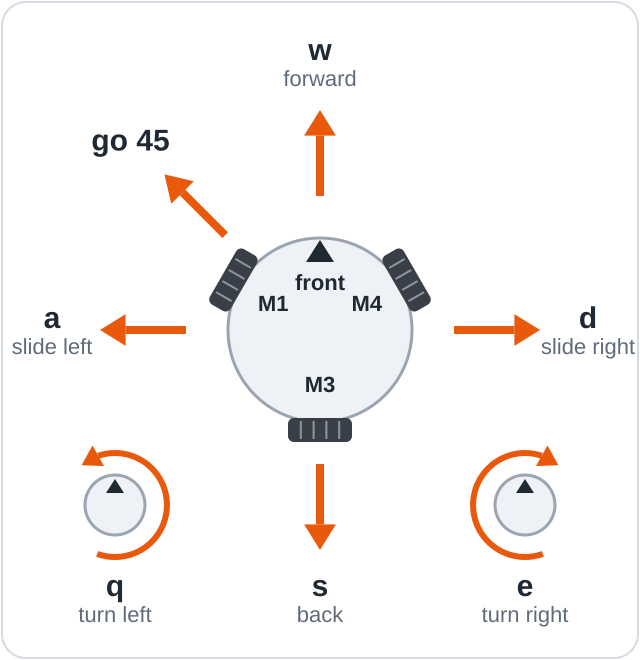

# Lesson 05: Keyboard driving

Drive the robot with keys typed in the Serial Monitor, with every move ended automatically by a
timer.

**Objectives**

- Read characters sent from the Serial Monitor.
- Select an action for each key with a `switch` statement.
- Use `millis()` to end a move without pausing the program.

## You will need

The setup from [lesson 04](../04_Drive_Any_Direction/README.md) with your wheel settings, a
long USB cable, and a clear floor area about 2 m across.

## Wiring

The wiring is the same as in [lesson 03](../03_Find_Your_Wheels/README.md#wiring).

## The code



The sketch is [05_Keyboard_Driving.ino](05_Keyboard_Driving.ino). The drawing shows the driving
keys (`go 45` belongs to the full program).

### Key lines explained

```cpp
  if (Serial.available() > 0) {
    char key = tolower(Serial.read());  // so W works as well as w
    handleKey(key);
  }
```

`Serial.available()` returns the number of received characters waiting to be read, and
`Serial.read()` takes one. `tolower()` makes `W` and `w` equivalent.

```cpp
    case 'w': Serial.println("forward");    drive(1, 0, 0);  break;
```

`handleKey()` uses a **switch statement**, which runs one block of code (a `case`) chosen by a
value. Each driving key calls lesson 04's `drive()`, and the `default` case stops the robot for
any unlisted key. The Enter characters `'\r'` and `'\n'` have an empty case, so Enter does not
stop the robot.

```cpp
  if (moving && millis() - moveStartMs >= MOVE_MS) {
```

`millis()` returns the number of milliseconds since the board started. `drive()` stores the time
of each driving key in `moveStartMs`; once `MOVE_MS` (1000 ms) has passed, the robot stops.
Because `loop()` never calls `delay()`, it acts on a stop key immediately.

## Upload and run

> [!CAUTION]
> From step 5 the robot moves across the floor. Stay close to it, keep the USB cable slack, and
> type `x` and Enter to stop.

1. Copy `WHEEL_ANGLE` and `FLIP_MOTOR` from your lesson 04 sketch into
   `05_Keyboard_Driving.ino`, and save.
2. Rest the robot on the mug or box. Switch SW off, connect the battery, then switch SW on.
3. Upload the sketch and open the Serial Monitor (115200 baud, **New Line**), as in
   [lesson 01](../01_Spin_One_Motor/README.md#upload-and-run).
4. Type each driving key, then Enter, and check that the wheels move as in lesson 04.
5. Place the robot on the floor with clear space around it, and drive.

## What you will see

About 2 s after the upload, the robot lists its keys (`h` and Enter lists them again):

```text
Keyboard driving. Type a key (in the Arduino IDE, then press Enter):
  w / s   forward / back         1 2 3 4 5   speed 20, 30, 40, 50, 60%
  a / d   left / right           x or space  stop
  q / e   turn left / right      h or ?      these keys again
Each key drives for 1000 ms, then the robot stops. Speed now: 30%
```

Each driving key moves the robot for 1 s; sending it again within that second keeps the robot
moving. Typing `w`, waiting, then `3`, `x` and an unused key such as `k` produces:

```text
forward
stopped (send the key again to keep going)
speed 40% (from the next key)
stop
stop (that key isn't used, h shows the keys)
```

> [!TIP]
> With PlatformIO, close the Arduino IDE's Serial Monitor and run `pio device monitor -f direct`
> in the project folder. Each key is then sent as it is pressed, without Enter, so holding `w`
> keeps the robot moving.

## How it works

Every move has a **timeout**, a time limit after which it ends automatically: 1 s after the last
driving key. If typing stops, the cable is disconnected or the computer freezes, the robot still
stops, and an unrecognised key stops it at once. The full program follows the same principle:
a typed move ends after its set time, and the phone joystick begins to stop the robot when the
driving page has been silent for 0.5 s.

> [!NOTE]
> **Key idea:** the robot keeps moving only while it receives valid commands. Silence, an unknown
> key or a lost connection all lead to a stop.

## If it doesn't work

| Symptom | Likely cause | Fix |
|---------|--------------|-----|
| Nothing happens when a key is typed | Typed outside the input box, or Enter not pressed | Type in the input box at the top of the Serial Monitor and press Enter. |
| The robot moves the wrong way | Wheel settings do not match the robot | See [lesson 04](../04_Drive_Any_Direction/README.md#if-it-doesnt-work). |
| The robot keeps stopping while driving | Each key lasts only 1 s | Send keys more often, use the tip above, or increase `MOVE_MS`. |

## Summary

- `Serial.available()` and `Serial.read()` receive typed characters one at a time.
- A `switch` statement maps each key to an action; unknown keys stop the robot.
- `millis()` measures time without pausing the program, which allows a timeout on every move.

**Next:** [First drive](../../../docs/05_First_Drive.md): enter the wheel settings in `config.h`
and drive with the full program.
